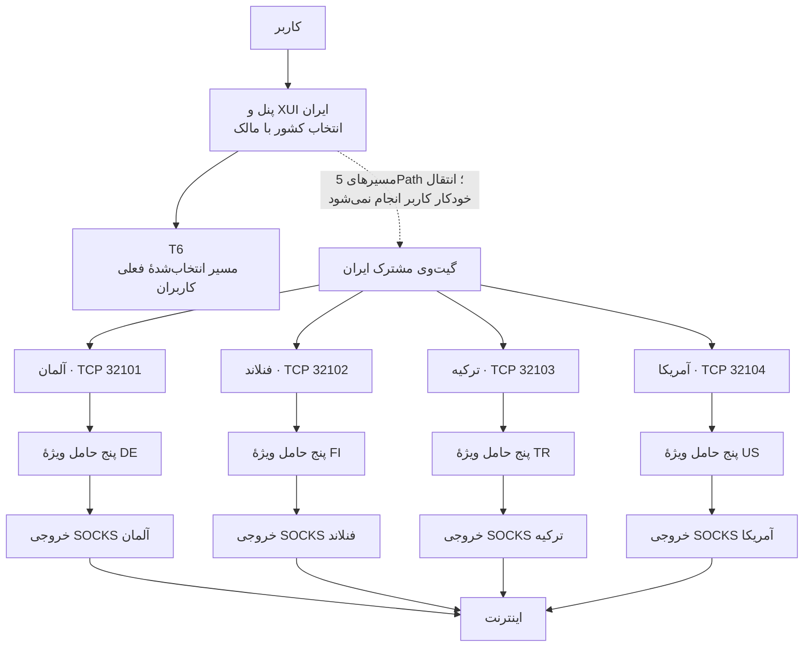
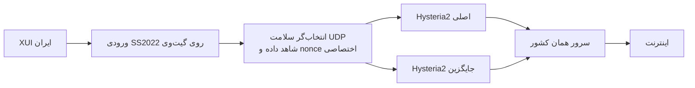

# 5Path — مستندات و اجزای سامانهٔ تونل چهارکشوری

<p dir="rtl">پروژهٔ 5Path برای ساخت مسیرهای مجزا به آلمان، فنلاند، ترکیه و آمریکا، بررسی سلامت واقعی مسیر و انتخاب مسیر جایگزین برای اتصال‌های جدید ایجاد شده است. این مخزن تاریخچهٔ فنی، کد اجزای قابل انتشار، آزمون‌ها و شواهد پالایش‌شده را نگه می‌دارد.</p>

**وضعیت ثبت‌شده در ۲۲ اکتبر ۲۰۲۶: بازنگری کیفیت و مصرف CPU در جریان است.** پس از شکایت کاربران از پینگ و سرعت، مالک کاربران را به T6 منتقل کرده است. اتصال‌های باقی‌مانده روی مسیرهای خودمان نیز مشاهده شده‌اند. انتشار کد یا ساخت Release به معنای نصب نسخه روی سرور، تأیید ظرفیت یا تأیید کیفیت برای همهٔ کاربران نیست.

## وضعیت واقعی قابلیت‌ها

| بخش | آنچه انجام شده | آنچه هنوز کامل نشده |
|---|---|---|
| TCP چهار کشور | چهار ورودی SOCKS5 احراز هویت‌شده و پنج حامل منطقی برای هر کشور ساخته شد؛ هنگام تحویل، ۲۹ فایل مستقل 16KiB و آزمون‌های جریان جدید ثبت شدند | کیفیت و ظرفیت زیر بار واقعی به نتیجهٔ مطلوب نرسیده؛ سلامت تاریخی تضمین سلامت فعلی نیست |
| UDP آلمان، فنلاند و آمریکا | ورودی SS2022 و دو نمونهٔ Hysteria2 برای هر کشور؛ در مجموع ۹ رسید واقعی شامل مسیر اصلی، مسیر جایگزین و بازگشت اصلی | بازی واقعی، حفظ نشست قبلی و ظرفیت انبوه اثبات نشده‌اند |
| UDP ترکیه | نمونهٔ TUIC آزمایش شد و منقضی شد؛ پذیرفته نشده است | تحویل UDP و پاک‌سازی ریشهٔ منقضی باقی‌مانده، پس از اثبات مالکیت و بی‌فعالیتی |
| مصرف CPU | baselineهای واقعی ۳۰۰ثانیه‌ای؛ واسط بومی ترکیه و آمریکا برای جریان جدید فعال شده است | کاهش CPU کل سرور با بار برابر هنوز تأیید نشده است |
| واسط سبک‌تر | ترکیه و آزمون تازهٔ مرحله‌ای آمریکا گیت قدیمی/سایه/منتشر را گذراندند؛ رد قبلی آمریکا در تاریخچه حفظ است | آلمان و فنلاند پذیرفته نشده‌اند؛ اصلاح چهار کشور کامل نیست |
| دیسک سرور ایران | مصرف ۹۱٪ به ۵۳٪ رسید؛ حدود ۶٫۱۹GB آزاد شد؛ ۹۲ سرویس و ۴۴ listener TCP بدون تغییر PID باقی ماندند | threshold لاگ‌ها هر ساعت بررسی می‌شود و سقف لحظه‌ای نیست |
| WARP | دارایی نرم‌افزاری محلی با SHA تأیید شده و طراحی جداسازی بررسی شده است | **هنوز روی US-5PATH نصب یا اعمال نشده است** |
| گزارش مدیر | PDF فارسی ۲۵صفحه‌ای پیش‌نویس و بررسی ظاهری شده است | نهایی و ارسال نشده؛ فایل پیش‌نویس در این مخزن منتشر نمی‌شود |

## شمای فنی TCP



هر کادر «پنج حامل» مجموعهٔ مستقل همان کشور شامل Waterwall Reverse، FRP TCP، FRP KCP، GOST HTTP2 و GOST gRPC است. خروجی و حامل کشورها با یکدیگر به اشتراک گذاشته نمی‌شوند و عبور از کشور واسط مجاز نیست. گیت‌وی محلی ایران بخشی از مسیر مجاز است. T6 تغییر نکرده و در دامنهٔ اصلاحات خودکار این پروژه قرار ندارد.

## شمای UDP جداگانه



دو نمونهٔ Hysteria2، دو نمونه از یک پروتکل‌اند. این ساختار استقلال دیتاسنتر، مسیر فیزیکی یا اپراتور را اثبات نمی‌کند. ورودی TCP پنج‌مسیره به‌تنهایی UDP ارائه نمی‌دهد. TCP عبوری از ورودی گیمینگ نیز به استخر TCP موجود تحویل داده می‌شود و به‌خودی‌خود مشکل CPU آن را حل نمی‌کند.

## پورت‌های ثبت‌شده

### ورودی TCP و اصلاح ظرفیت خروجی

| کشور | ورودی TCP گیت‌وی | خروجی قدیمی روی loopback کشور | خروجی اصلاح ظرفیت روی loopback | سقف Gateway پایتون قبلی |
|---|---:|---:|---:|---:|
| آلمان | 32101 | 24239 | 24250 | 4096 |
| فنلاند | 32102 | 24339 | 24350 | 2048 |
| ترکیه | 32103 | 24305 | 24326 | 1024 |
| آمریکا | 32104 | 24271 | 24282 | 2048 |

جمع سقف‌های Gatewayهای پایتون قبلی **۹۲۱۶** است. این عدد ظرفیت اندازه‌گیری‌شده یا تضمین اتصال هم‌زمان نیست. سقف‌های خروجی نیز ظرفیت جداگانهٔ کاربران محسوب نمی‌شوند؛ یک اتصال در دو سمت دیده می‌شود. هدف ۸۰هزار اتصال و افزایش خودکار ظرفیت پیاده‌سازی یا تأیید نشده‌اند.

**سقف قبلی به واسط بومی منتقل نشده است.** در نسخهٔ بومی آمریکا و ترکیه، محدودیت حافظه، task و فایل باز وجود دارد، اما این محدودیت‌ها معادل شمارش و رد اتصال اضافه در Gateway قبلی نیستند. سقف تجمیعی اتصال‌های قدیمی و بومی نیز اعمال نشده است. گسترش نصب به کشور بعدی تا بررسی و آزمون کنترل پذیرش متوقف است؛ جزئیات در [کنترل اتصال‌های بومی](docs/NATIVE-FRONT.fa.md#محدودیت-پذیرش-اتصال) آمده است.

نمونهٔ relay محلیِ دارای سقف، آزمون N/N+1 و حفظ جریان‌های باز را گذراند، اما CPU مجموعهٔ native+relay در نمونهٔ برابر0.49s در مقابل0.24s قبلی شد؛ بنابراین **رد شد و نصب نشد**. آزمون مستقل روی کد عمومی نیز همین جهت افت را نشان داد. [شواهد مثبت و منفی محلی](evidence/native-admission-local.json) و [شرح نمونهٔ آزمایشی](docs/NATIVE-FRONT.fa.md#نمونهٔ-محلی-کنترل-پذیرش-رد-به-علت-هزینهٔ-cpu) را ببینید؛ گیت نصب همچنان بسته است.

نسخهٔ بعدی کنترل پذیرش، داخل خود listener بومی و بدون relay پایتون ساخته و فقط در توسعه آزمایش شد. آزمون واقعی N/N+1، حفظ جریان‌های مستقل هنگام خطا، timeout و half-close گذشت. نمونهٔ CPU محلی برای نسخهٔ داخلی0.19s، pristine0.16s و Gateway قدیمی0.24s بود؛ این نمونهٔ کوتاه، برابری کارایی یا کاهش CPU سرور را ثابت نمی‌کند. **نصب تولیدی انجام نشد و سقف تجمیعی K هنوز حل نشده است.** [شرح فنی، patch، منشأ ساخت و محدودیت‌ها](docs/NATIVE-ADMISSION-INLINE.fa.md) را ببینید.

اصلاح ظرفیت قبلی با rule محدود `OUTPUT` و `SYN`، اتصال‌های جدید را از پورت قدیمی به خروجی جدید می‌فرستد. بنابراین خروجی واقعی جدید US-5PATH روی **24282** است. تغییر فرایند قدیمی روی 24271 به‌تنهایی، WARP را به جریان‌های جدید اعمال نمی‌کند. این ruleها باید پیش از هر تغییر، با ممیزی معنایی NAT و conntrack بررسی شوند.

### پورت‌های UDP تحویل‌شده

| کشور | ورودی SS2022 گیت‌وی | H2 اصلی / جایگزین در کشور | ورودی اجباری اصلی / جایگزین | API محلی | سلامت |
|---|---:|---|---|---:|---:|
| آلمان | 9450 | 9461 / 9462 | 9451 / 9452 | 9453 | 9469 |
| فنلاند | 9550 | 9561 / 9562 | 9551 / 9552 | 9553 | 9569 |
| آمریکا | 9750 | 9761 / 9762 | 9751 / 9752 | 9753 | 9769 |
| ترکیه | تحویل نشده | طرح‌های قبلی قابل استفاده فرض نمی‌شوند | — | — | — |

APIها محلی‌اند. پورت‌های تست اجباری، خروجی عمومی بدون احراز هویت نیستند. هر تخصیص تازه باید دوباره از نظر listener، rule، NAT، namespace و محدودهٔ پورت‌های موقت ممیزی شود.

## نتیجهٔ بررسی CPU و کیفیت

| سنجه | پیش از انتقال مالک به T6 | پس از انتقال مالک به T6 |
|---|---:|---:|
| CPU گیت‌وی، میانگین کامل ۳۰۰ثانیه | 97.12٪ | 42.32٪ |
| CPU سرور آلمان، میانگین کامل ۳۰۰ثانیه | 95.72٪ | 37.10٪ |
| مجموع مصرف چهار slice متعلق به TCPهای خودمان روی گیت‌وی | 3.317 هسته | 0.392 هسته |

کاهش بالا نتیجهٔ انتقال ترافیک توسط مالک است؛ در این مرحله تنظیم سرور توسط عامل تغییر نکرد. مقایسه، آزمایش کنترل‌شده با بار مساوی نیست. در مشاهدهٔ بعدی، اتصال‌های باقی‌مانده و تازه، به‌ویژه روی آلمان، دیده شدند.

در مسیرهای زیر بار، چند وزن انتخاب مسیر به کف مشترک `0.05` می‌رسیدند و تفاوت کیفیت مسیرها کم‌رنگ می‌شد. سقف اتصال‌ها در نمونه‌های بررسی‌شده پر نشده بود و hard CPU quota فعال روی سرویس‌های نمونه‌شده دیده نشد. محدودکردن کورکورانهٔ CPU، راه‌حل این مشکل نیست و ممکن است صف و تأخیر را بدتر کند.

نمونهٔ جایگزین محلی، کنترل سلامت را از جابه‌جایی داده جدا می‌کند. در آزمون loopback با داده و upstream یکسان، CPU فرایند واسط از **0.43 به 0.29 ثانیه** رسید. این عدد فقط هزینهٔ همان فرایند محلی را مقایسه می‌کند؛ کاهش CPU کل سرور یا افزایش سرعت اینترنت را ثابت نمی‌کند. جزئیات در [گزارش کارایی](docs/PERFORMANCE.fa.md) و [دادهٔ پالایش‌شده](evidence/cpu-incident.json) آمده است.

در نصب محدود ترکیه، همان فایل 16KiB از Gateway قبلی در **0.554s**، پورت سایهٔ بومی در **0.249s** و ورودی اصلی پس از انتشار در **0.349s** دریافت شد؛ هر سه SHA مطابق بود. تنها جریان‌های جدید TCP 32103 به واسط بومی 8871 می‌روند و اتصال‌های قدیمی روی فرایند قبلی ادامه دارند. این نتیجهٔ کوچک، سرعت دانلود، پینگ بازی یا ظرفیت کاربران را ثابت نمی‌کند. نتیجهٔ ناموفق آمریکا و وضعیت سایر کشورها نیز در گزارش کارایی حفظ شده است.

در آزمون تازهٔ آمریکا، پس از baseline و origin و nonce تازه، همان فایل در حالت قدیمی **1.167s**، سایه **0.778s** و ورودی منتشرشده **0.948s** ثبت شد. گیت سخت‌تر پیش و پس از انتشار گذشت و جریان‌های جدید TCP 32104 به واسط بومی 8681 می‌روند. فرایند committed و Gateway قبلی همان PID را داشتند. **WARP جزء این تغییر نیست و هنوز نصب نشده است.**

در پایش خواندنی بعدی، CPU کامل ۳۰۰ثانیه‌ای GW **37.54٪** و IR **53.79٪** بود. سهم system/softirq روی GW زیاد بود، اما به تونل خاصی نسبت داده نشد. نمونهٔ جداگانهٔ چهار slice کشور و دو واسط بومی روی GW در پنجرهٔ60.06ثانیه‌ای مجموعاً **0.2252 هسته** مصرف نشان داد؛ این دو پنجره مقایسهٔ بار برابر نیستند. SSH pinned آلمان و فنلاند نیز برگشته است. [دادهٔ پوشش و حدود اندازه‌گیری](evidence/cpu-attribution-latest.json) و [گزارش کارایی](docs/PERFORMANCE.fa.md#انتساب-تازهٔ-cpu-و-پوشش-sliceها) را ببینید.

## محدودهٔ WARP

درخواست مالک دقیقاً **US-5PATH روی TCP 32104** است. WARP برای T6، سایر کشورها، XUI یا UDP/H2 آمریکا مجاز نشده است. طراحی باید خروجی همان سرویس را جدا کند و default route، DNS یا NTP سراسری میزبان را تغییر ندهد. پروفایل، کلید و rule باید مستقل و متعلق به همین تغییر باشند. افزایش lease TTL یا دورزدن TLS مجاز نیست.

**وضعیت این انتشار: WARP نصب یا اعمال نشده است.** فایل تأییدشدهٔ محلی و آزمون namespace محلی، شاهد نصب یا اتصال WARP روی سرور نیستند.

## اجرای آزمون‌های محلی

این مخزن نصب‌کنندهٔ خودکار سرور ندارد. IPهای داخل کد منتشرشده، با محدوده‌های مخصوص مثال جایگزین شده‌اند؛ نسخهٔ عمومی کپی مستقیم تنظیمات فعال سرورها نیست.

در یک محیط توسعهٔ جداگانه با Python 3.12:

```bash
python -m venv .venv
# محیط مجازی را مطابق سیستم‌عامل فعال کنید.
python -m pip install -r requirements-dev.txt
python tools/run_tests.py
python tools/check_public_tree.py
```

آزمون‌های عادی، SSH، نصب، تغییر XUI یا ترافیک WAN ندارند. آزمون گیرندهٔ منبع در `integration/` به Linux، root و namespace شبکه نیاز دارد و جزو آزمون پیش‌فرض نیست. آن را روی سرور کاربران اجرا نکنید. گیت‌های محلی جای baseline واقعی ۳۰۰ثانیه‌ای و ممیزی سرور را نمی‌گیرند.

آزمایش CPU محلی نیز در `integration/native_front_local_fixture.py` موجود است. مسیر binary محلیِ تأییدشدهٔ sing-box با متغیر `SING_BOX_BINARY` داده می‌شود و SHA آن پیش از اجرا کنترل می‌شود؛ دانلود خودکار انجام نمی‌شود. این آزمایش فقط روی loopback محیط توسعه اجرا می‌شود. آزمون namespace مربوط به socket mark نیز در `integration/` است و به‌تنهایی نصب WARP را ثابت نمی‌کند.

## ساختار مخزن

| مسیر | محتوا |
|---|---|
| `core/` | اجزای TCP، UDP، مالکیت منابع، guard، ممیزی rule و گیرندهٔ محدود منبع |
| `experimental/` | نمونهٔ محلی واسط سبک‌تر؛ هنوز deploy نشده |
| `tests/` | آزمون‌های قابل اجرای بدون سرور |
| `integration/` | آزمون محدود گیرنده در محیط Linux جداگانه |
| `docs/` | معماری، عملیات، کارایی، تاریخچه و سیاست انتشار |
| `evidence/` | فقط سنجه‌ها و رسیدهای پالایش‌شده، بدون credential و تنظیمات خصوصی |
| `.github/workflows/` | بررسی کد و انتشار نسخهٔ مستقل برای هر تغییر ثبت‌شده روی `main` |

## نسخه‌بندی و انتشار

هر نوبت تغییر منتشرشده روی `main`، پس از عبور از آزمون‌ها و کنترل خروجی عمومی، Release جدید با شمارهٔ یکتا می‌سازد. تغییر محلیِ ذخیره‌نشده روی GitHub، نصب سرور محسوب نمی‌شود. نسخه‌های فعلی `0.x` و پیش‌انتشارند؛ آماده‌بودن برای کاربران با مدرک مستقل ثبت می‌شود.

برای هر انتشار، ZIP کد همان commit و SHA256 آن ثبت می‌شود. این ZIP، کانفیگ خصوصی یا PDF پیش‌نویس ندارد. قواعد کامل در [سیاست انتشار](docs/RELEASING.fa.md) و مسیر تکمیل در [تاریخچه و کارهای باقی‌مانده](docs/HISTORY.fa.md) آمده است.

## اسناد تکمیلی

- [معماری، N-1 و نقاط خرابی مشترک](docs/ARCHITECTURE.fa.md)
- [کارایی، واحدها و حدود شواهد](docs/PERFORMANCE.fa.md)
- [واسط بومی و حفظ اتصال‌های باز](docs/NATIVE-FRONT.fa.md)
- [پاک‌سازی دیسک و نگه‌داری محدود لاگ](docs/STORAGE.fa.md)
- [عملیات، مالکیت و گیت‌های تغییر](docs/OPERATIONS.fa.md)
- [تاریخچه و وضعیت کارهای باقی‌مانده](docs/HISTORY.fa.md)
- [نسخه‌بندی و Release](docs/RELEASING.fa.md)
- [منابع نرم‌افزارهای بالادست](docs/UPSTREAM.fa.md)

گزارش‌های تاریخیِ موفق، مشکل گزارش‌شدهٔ کاربران زیر بار را رد نمی‌کنند. معیار ادامهٔ کار، اندازه‌گیری تازه و کیفیت واقعی است.
