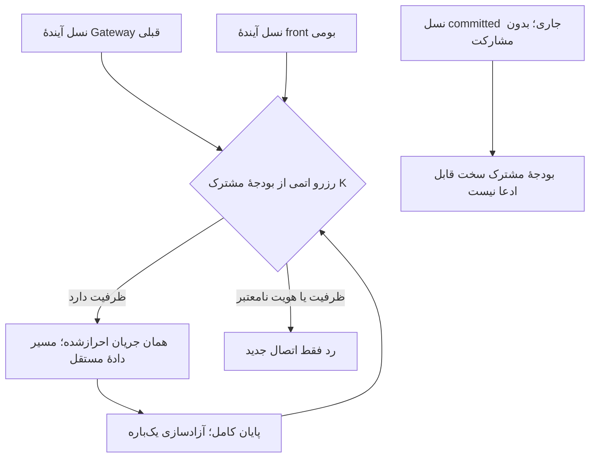

# قرارداد ساخت بومی و سقف تجمیعی

نمونهٔ فعلی کنترل داخلی، سقف هر listener را در توسعه درست اجرا می‌کند؛ هنوز مجوز نصب نیست. این بررسی مشخص کرد که شمارش مستقل front قبلی و جدید، به‌تنهایی سقف سخت مجموع K را حفظ نمی‌کند. سرویس‌های committed فعلی در این مرحله دست‌کاری نشدند.

## چرا snapshot کافی نیست

Gateway قبلی، handler را پیش از handshake به مجموعهٔ داخلی `_connections` اضافه و پس از پایان کامل handler از آن حذف می‌کند. فایل state، تعداد این مجموعه را منتشر نمی‌کند. `active_connections` پس از رسیدن درخواست به اتصال upstream زیاد می‌شود؛ در نتیجه کلاینت بدون بایت، منتظر احراز هویت یا منتظر درخواست کامل در آن نیست. `connections_total` نیز شمارندهٔ تجمعی است.

حتی افزودن یک شمارنده به snapshot دوره‌ای مشکل اتمی‌بودن را حل نمی‌کند. برای نمونه، K=3 است؛ observer یک اتصال قدیمی می‌بیند و front جدید دو جایگاه می‌دهد. سپس یک کلاینت دیگر وارد front قدیمی می‌شود: مجموع چهار است، درحالی‌که هر دو front سقف مستقل خود را رعایت کرده‌اند. برداشتن redirect هنگام خرابی نیز می‌تواند پذیرش مستقل قبلی را دوباره باز کند.

با وضعیت فعلی، کران محافظه‌کارانهٔ نسل قدیمی همان K است؛ رزرو تمام این کران، برای نسل جدید صفر جایگاه تضمین‌شده باقی می‌گذارد. شمارش حافظه، task، FD یا اتصال‌های موفق جای این قرارداد را نمی‌گیرد. این نتیجه مجوز توقف یا restart نسل قدیمی نیست.

## مسیرهای قابل بررسی

| روش | نتیجه و محدودیت |
|---|---|
| سقف مستقل N در native | محلی آزموده شده؛ مجموع با سقف قبلی K، حداکثر K+N است و برابری با K نیست. |
| تخمین دوره‌ای از state و کم‌کردن از K | handshakeهای خصوصی و رقابت read→admit را پوشش نمی‌دهد؛ برای ادعای سخت K رد می‌شود. |
| مشارکت هر دو نسل در allocator اتمی مشترک | مسیر پیشنهادی برای نسل آینده؛ باید پیش از احراز هویت و ایجاد کار اتصال، جایگاه یکسان را بگیرد. روی نسل جاری اعمال نشده است. |
| مرز ورودی اثبات‌شده همراه حساب محافظه‌کارانهٔ همهٔ جریان‌های قبلی | گزینهٔ جایگزین، با نیاز به آزمون واقعی backlog، handshake معطل، fallback، IPv4/IPv6 و namespaceها؛ فعلاً اثبات نشده و rule جدیدی نصب نشده است. |

جهت پیشنهادی، allocator مشترک برای کنترل پذیرش است؛ داده از همان مسیر بومی می‌رود و relay دادهٔ پایتون اضافه نمی‌شود. صرفاً نام‌بردن از semaphore یا broker، پیاده‌سازی محسوب نمی‌شود. نسخهٔ قبلی نیز باید در قرارداد شرکت کند؛ observer جای آن را نمی‌گیرد.

allocator آینده باید boot، run، کشور، K و هویت تمام شرکت‌کنندگان را ثابت کند. موفقیت handshake یا FIN اول نباید جایگاه را آزاد کند. خرابی allocator فقط پذیرش جدید را متوقف می‌کند؛ جریان زنده قربانی بازیابی شمارنده نمی‌شود. گم‌شدن token می‌تواند دسترس‌پذیری را کم کند، اما نباید با reset شمارنده ظرفیت تازه اختراع شود. ساخت مجدد بودجه، unlink و reclaim تا وقتی شرکت‌کننده یا جریان قبلی زنده یا نامعلوم است مجاز نیست. مسیر fallback نیز باید از همین بودجه عبور کند.

این مسیر نیازمند آزمون بین دو فرایند واقعی با pending، N+1، half-close، خطا، crash، بازیافت PID، قطع allocator و حفظ payload است. هزینهٔ کنترل پذیرش در نرخ اتصال تازه و هزینهٔ worker/watchdog نیز باید جدا اندازه‌گیری شوند. نمونهٔ انتقال دو جریان برقرار، این هزینه‌ها را پوشش نمی‌دهد.

## ثبت ساخت به‌صورت مستقل

[شناسهٔ نامزد ساخت](../evidence/native-build-candidate.json) فقط یک گزارش محلی با `production_eligible=false` است؛ registry یا راه بازکردن گیت نصب نیست. این شناسه، commit بالادست، کامپایلر، h1 و محدودیت اعتبارسنجی آن، patch، فایل‌های تغییرکرده، go.mod/go.sum و SHA/اندازهٔ دو binary را نگه می‌دارد. binary و مسیر خصوصی توسعه منتشر نشده‌اند.

در اتصال آینده به چرخهٔ نصب، این نقاط باید با هم به رسید immutable متصل شوند:

1. پیش از ساخت controller یا SSH، قرارداد و شناسهٔ ساخت بررسی شوند؛ هیچ گزینهٔ bypass اضافه نشود.
2. binary مخصوص front، descriptor مستقل داشته باشد. ثابت مشترک دارایی UDP/gaming برای این کار تغییر نکند.
3. پیکربندی، قابلیت واقعاً شناخته‌شدهٔ binary، قرارداد سقف و hash کد policy/runtime پیش از commit در مالکیت نسل تازه ثبت شوند. فایل committed قبلی درجا ویرایش نشود.
4. پذیرش محلی lifecycle باید به همین binary، config و قرارداد متصل باشد؛ تطبیق hash فقط دو فایل policy/config کافی نیست.
5. worker و watchdog در آماده‌بودن، PID، زمان آغاز، boot، cgroup، binary و config یکسان را بررسی کنند. انتخاب عضو سالم یا readback API، allocator اتمی اتصال نیست.

تا تکمیل این موارد و اثبات سقف تجمیعی، گیت نصب همچنان بسته است. پذیرش محدود قبلی آمریکا و ترکیه و داده‌های شکست تاریخی تغییر نکرده‌اند. T6، XUI، مسیر کاربران و سرویس تولیدی restart نشدند. WARP، UDP ترکیه، ظرفیت و PDF نهایی نیز هنوز کامل نشده‌اند.
