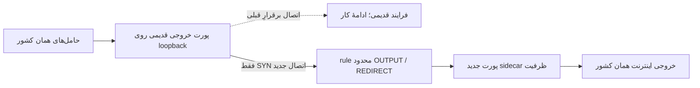

# معماری فنی و دامنهٔ تحمل خرابی

## نقش‌ها

`IR` میزبان پنل و XUI در ایران است. `GW` گیت‌وی مشترک محلی ایران است. چهار سرور مقصد در کشورهای DE، FI، TR و US قرار دارند. در نسخهٔ عمومی، آدرس‌های نمونه از محدوده‌های مستندسازی انتخاب شده‌اند؛ نشانی سرورها و credential واقعی منتشر نشده‌اند.

در مسیر TCP، انتخاب کشور در اختیار مالک است. هر ورودی گیت‌وی، SOCKS5 احراز هویت‌شده و متعلق به یک کشور است. حامل‌ها به SOCKS خروجی همان کشور متصل می‌شوند. کاربر برای هر اتصال TCP به یک حامل تخصیص داده می‌شود؛ یک اتصال واحد هم‌زمان روی پنج حامل تقسیم نمی‌شود.

| حامل | نقش و ویژگی مهم |
|---|---|
| Waterwall Reverse | حامل معکوس مستقل؛ خرابی قبلی نمونهٔ آلمان ثبت شده و خودکار دست‌کاری نشده است |
| FRP TCP | انتقال بر پایهٔ TCP با TLS و بررسی هویت سرور |
| FRP KCP | انتقال KCP روی UDP؛ رفتار آن از نظر CPU، ارسال مجدد و کیفیت با TCP یکسان فرض نمی‌شود |
| GOST HTTP2 | حامل مبتنی بر HTTP/2؛ پردازش و multiplexing در فضای کاربر انجام می‌شود |
| GOST gRPC | حامل مبتنی بر gRPC؛ از نظر فیزیکی مستقل از سایر حامل‌های همان میزبان نیست |

پنج نام بالا، تنوع پروتکل منطقی ایجاد می‌کنند. همهٔ آن‌ها ممکن است NIC، پردازنده، مسیر WAN، برق و سرور مقصد مشترک داشته باشند.

## کنترل سلامت فعلی TCP

Gateway برای هر upstream، SOCKS handshake و درخواست کوچک به health اختصاصی همان کشور می‌فرستد و nonce پاسخ را می‌سنجد. موفقیت اتصال به پورت به‌تنهایی سلامت مسیر داده محسوب نمی‌شود. حالت `balance`، اتصال‌های جدید را با توجه به تعداد اتصال فعال و وزن مؤثر توزیع می‌کند. حالت `failover` ترتیب و سلامت را برای انتخاب مسیر به کار می‌برد.

وزن مؤثر نسخهٔ فعلی از وزن پایه، نسبت probe موفق، میانگین تأخیر و jitter ساخته می‌شود. کف مشترک `0.05` در افت شدید کیفیت می‌تواند مسیرهای متفاوت را هم‌وزن کند. این رفتار در ممیزی واقعی دیده شد و برای اصلاح ثبت شده است. وجود API یا حالت انتخاب مسیر به معنای کنترل انتخاب کشور در XUI نیست.

## اصلاح ظرفیت قبلی بدون قطع اتصال باز

این اصلاح، فرایند قبلی را متوقف نکرد. owner و manifest با `capacity_revision` به‌روزرسانی شدند و هویت commit قدیمی برای guard در حال اجرای قبلی حفظ شد. تفاوت SHA اصلی commit با manifest جاری، در صورت تأیید زنجیرهٔ `capacity_revision` و رسید قبلی، خرابی نیست. بازگرداندن manifest قدیمی یا حذف sidecar پذیرفته‌شده مجاز نیست.

در آمریکا، جریان جدید از loopback 24271 به 24282 هدایت می‌شود. این جزئیات برای WARP مهم است: rule و خروجی مؤثر باید ممیزی شوند تا تغییر روی فرایند بیکار اعمال نشود.

## UDP و معیار پذیرش تاریخی

در سه کشور DE/FI/US، ورودی SS2022 روی GW به دو نمونهٔ Hysteria2 همان کشور متصل است. انتخاب‌گر، سلامت UDP را با شاهد داده بررسی می‌کند. برای هر کشور سه رسید مستقل ثبت شد:

1. مسیر اصلی با فایل 16KiB، SHA مطابق و ۲۴ پاسخ از ۲۴ echo.
2. مسیر جایگزین پس از قطع واقعیِ فقط حامل آزمایشی اصلی همان اجرا.
3. بازگشت اصلی با PID تازه و تکرار بررسی داده.

کنترل boot، hash، PID، `NRestarts=0`، post-guard و خروج واقعی کنترلر بخشی از تحویل بود. این رویدادها تاریخی‌اند؛ تکرار تست خرابی روی سرویس منتشرشده مجاز نیست. ترکیه چنین تحویل پذیرفته‌شده‌ای ندارد.

## N-1 و محدودیت ظرفیت باقی‌مانده

اگر یک حامل از استخر خارج شود، اتصال‌های جدید می‌توانند از حامل سالم دیگری در همان کشور استفاده کنند. این تنها وقتی مفید است که آن حامل واقعاً سالم باشد و ظرفیت آزاد کافی داشته باشد.

برای تضمین ظرفیت پس از خرابی، باید ظرفیت قابل استفادهٔ حامل‌های باقی‌مانده و منابع مشترک اندازه‌گیری شوند. جمع‌زدن عددهای تنظیم‌شدهٔ اتصال، جای آزمون ظرفیت را نمی‌گیرد. در این پروژه ظرفیت آزاد قابل اتکای N-1، ظرفیت ۸۰هزار اتصال و WAN کامل سایت تأیید نشده‌اند.

نقاط خرابی مشترک عبارت‌اند از IR، GW، پردازنده و NIC گیت‌وی، برق و شبکهٔ سایت، مسیر WAN مشترک، سرور خارجی همان کشور، مسیر مدیریت و سرویس پنل. خرابی یک نقطهٔ مشترک ممکن است هم‌زمان چند حامل منطقی را از دسترس خارج کند.

## واسط سبک‌تر پیشنهادی

نمونهٔ محلی در `experimental/`، جابه‌جایی بایت‌ها را به هستهٔ بومی می‌سپارد و سلامت nonce-verified موجود را برای انتخاب مسیر به کار می‌برد. انتخاب‌گر باید فقط اتصال‌های جدید را تغییر دهد، در نبود شاهد معتبر اتصال جدید را رد کند و به خروجی کشور دیگر یا direct ناخواسته نرود.

یک ناسازگاری واقعی در بررسی طراحی پیدا شد: URLTest نرم‌افزار sing-box درخواست `HEAD` می‌فرستد، ولی health موجود فقط `GET` را می‌پذیرد. به همین دلیل نمونهٔ سادهٔ URLTest برای نصب مناسب نیست و کنترل سلامت موجود باید حفظ شود. نمونهٔ selector محلی جایگزین این طراحی ساده شده است؛ هنوز گیت انتشار روی سرور را طی نکرده است.
