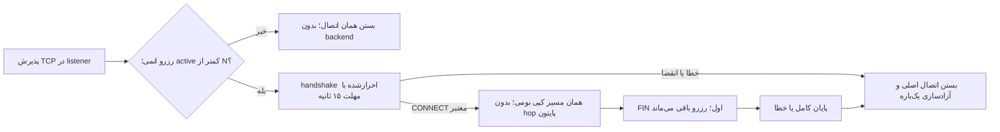

# کنترل پذیرش داخل واسط بومی؛ فقط نمونهٔ محلی

برای حذف هزینهٔ relay اضافی پایتون، شمارش اتصال در خود listener نسخهٔ مشخص sing-box پیاده‌سازی و در محیط توسعه ساخته شد. این کد روی سرور نصب نشده و گیت نصب کشور بعدی همچنان بسته است. واسط‌های committed آمریکا و ترکیه همان نسخهٔ قبلی را دارند. T6، XUI و مسیر کاربران در این مرحله تغییری نکردند.

[patch منبع](../experimental/patches/sing-box-v1.14.3-tcp-admission.patch)، [fixture واقعی](../integration/native_inline_fixture.py) و [شواهد پالایش‌شده](../evidence/native-inline-admission-local.json) در مخزن هستند. binary، کامپایلر، کانفیگ خصوصی و رسید خام controller منتشر نشده‌اند.

## رفتار دقیق نمونه



گزینهٔ `five_path_tcp_admission_limit` فقط به ساخت سفارشی این patch اضافه شده است. binary رسمیِ بدون patch این گزینه را رد می‌کند؛ هرگز آن را به کانفیگ binary جاری سرور اضافه نکنید. مقدار مجاز از صفر تا ۴۰۹۶ است؛ صفر رفتار عادی و بدون این کنترل را نگه می‌دارد. فعال‌کردن آن به users احرازشده و نبود inbound detour نیاز دارد. این نمونه TCP-only است و UDP ASSOCIATE و هر دو مقصد UoT را رد می‌کند.

رزرو پیش از ساخت goroutine اتصال انجام می‌شود و زمان handshake را نیز حساب می‌کند. callback پایانی با `sync.Once`، ابتدا اتصال پذیرفته‌شدهٔ اصلی را می‌بندد و سپس شمارنده را کم می‌کند. موفقیت handshake به‌تنهایی رزرو را آزاد نمی‌کند. مهلت خواندن پس از CONNECT معتبر پاک می‌شود؛ اتصال برقرار و بی‌ترافیک با مهلت handshake قطع نمی‌شود. FIN یک‌طرفه، ظرفیت را پیش از دریافت پاسخ سمت دیگر آزاد نمی‌کند.

**این سقف، تجمیعی نیست.** اگر Gateway قدیمی سقف K و front جدید سقف N داشته باشند، مجموع سقف کاربردی آن‌ها K+N است. fixture با K=3 و N=3، شش اتصال هم‌زمان را نگه داشت. SYN و backlog کرنل جدا هستند. snapshot قبلی، تمام handshakeهای معطل Gateway را نشان نمی‌دهد؛ بنابراین از آن نمی‌توان برابری سخت مجموع با K را اثبات کرد. این محدودیت حل نشده است.

## نتیجهٔ اجرا در توسعه

ساخت pristine و patched با یک کامپایلر Go1.25.5، همان وابستگی‌ها، CGO خاموش و tag برابر `with_clash_api` انجام شد. منبع بالادست sing-box v1.14.3 در commit زیر ثابت است:

`7054cac5124465ffdb145870d7c01885566711b1`

SHA256 patch:

`b5cf6e62ee2f2047f11526364827de08623e2e5efa0f79ce476ba239b61f379f`

آزمون Go، رزرو هم‌زمان و آزادسازی یک‌باره را گذراند. fixture واقعی در namespace تازه با تنها interface لوپ‌بک، این موارد را بررسی کرد:

- سه اتصال بدون ارسال حتی یک بایت و رد چهارمی پیش از بازشدن backend؛ سپس حفظ سه اتصال احرازشده و SHA payload.
- انقضای سه نوع handshake ناقص در حدود ۱۵ثانیه و حفظ اتصال برقرار پس از گذشت همین مهلت.
- خطای رمز، backend، بستهٔ نامعتبر، UDP ASSOCIATE و هر دو UoT؛ حفظ دو جریان مستقل، آزادشدن فقط یک جایگاه و رد اتصال اضافه.
- حفظ جریان باز هنگام تغییر selector جریان‌های جدید به reject؛ حفظ PID و زمان آغاز فرایندها.
- حفظ رزرو در FIN اول، دریافت پاسخ با SHA صحیح و آزادشدن دقیق یک جایگاه پس از پایان کامل.

تمام فرایندهای متعلق به fixture جمع شدند. ترافیک آزمون WAN و اتصال SSH صفر بود. بررسی جدول UDP در دو انتها، socket باقی‌مانده نشان نداد؛ syscallهای bind گذرا trace نشده‌اند. این مشاهده را اثبات مستقل «هیچ bind گذرا رخ نداده» ندانید؛ deny-listener در patch به‌صورت جداگانه قابل بررسی است.

| front در نمونهٔ محلی برابر | CPU کل همان فرایند | RSS مشاهده‌شده | زمان انتقال |
|---|---:|---:|---:|
| Gateway پایتون قبلی | 0.24s | حدود 21.64MiB | 0.479s |
| بومی pristine با همان کامپایلر | 0.16s | حدود 36.00MiB | 0.465s |
| بومی دارای کنترل داخلی | 0.19s | حدود 37.08MiB | 0.521s |

هر حالت دو اتصال و 32MiB در هر جهت روی loopback داشت؛ بلوک داده 16KiB بود. نمونه کوتاه و ترتیبی است؛ دقت حساب CPU فرایند حدود 10ms و سن runtime، ترتیب و GC کنترل نشده‌اند. عدد جدید از Gateway قدیمی کمتر و از pristine بیشتر شد. این نتیجه، پذیرش برابری CPU با pristine، کاهش CPU کل سرور زیر بار برابر، افزایش سرعت اینترنت یا کیفیت بازی را ثابت نمی‌کند. پیش از پذیرش کارایی، مقایسهٔ متوازن با عمر runtime برابر و پوشش همهٔ اجزا لازم است؛ تکرار بی‌هدف benchmark انجام نمی‌شود.

شکست‌های اولیه نیز در شواهد خلاصه شده‌اند: ساخت اول به‌علت import اشتباه ثابت‌های UoT کامپایل نشد؛ alias در revision دوم اصلاح شد. fixture اول، reset مورد انتظار هنگام رد UDP را خطا حساب می‌کرد و بررسی failure آن جریان مستقل زنده نداشت. این موارد اصلاح شدند و اجرای ناقص، پذیرش کامل شمرده نشد. شواهد منفی relay پایتون قبلی نیز حذف نشده‌اند.

## بازتولید محدود و محلی

این بخش نصب‌کننده نیست. روی سرور کاربران اجرا نشود. ابتدا منبع commit بالا را در یک ریشهٔ توسعهٔ تازه برای pristine و patched آماده کنید. patch را با `git apply --check` و سپس `git apply` فقط روی کپی patched اعمال کنید. با Go1.25.5 و محیط و cache مستقل، هر دو را با `CGO_ENABLED=0 GOTOOLCHAIN=local` و فرمان یکسان زیر بسازید؛ خروجی هر کپی باید در فایل جداگانه باشد:

```bash
go test -p=2 -count=1 -run TestFivePathAdmission -v ./common/listener
go build -p=2 -trimpath -tags with_clash_api -ldflags='-s -w' -o /مسیر/خروجی/جدا ./cmd/sing-box
```

آزمون Go فقط در کپی patched وجود دارد. دریافت منبع، کامپایلر و moduleها در مرحلهٔ build به شبکه نیاز دارد؛ صفر WAN گزارش‌شده مربوط به fixture داده است. toolchain محلی با Go module رسمی و تطبیق h1 با lookup رسمی TLS دریافت شد؛ امضای log مربوط به sumdb به‌صورت مستقل بررسی نشده است. اعتبارسنجی moduleهای Go هنگام build فعال بود و go.mod/go.sum تغییر نکردند.

fixture فقط در namespace تازه با یک `lo` اجرا می‌شود. `FIVEPATH_INLINE_BUILD_MANIFEST` باید مسیر رسید ساخت محلی با `phase=BUILT_NOT_DEPLOYABLE`، `patch_sha256` بالا و بخش `binaries` باشد؛ هر binary زیر کلید pristine یا patched، `path` و `sha256` واقعی می‌خواهد. `FIVEPATH_LOCAL_BUILD_ROOT` باید ریشهٔ مستقل توسعه باشد که `ownership.json` آن `purpose=LOCAL_NATIVE_ADMISSION_BUILD_ONLY` دارد. fixture پیش از اجرای binaryها SHA را کنترل می‌کند. این marker و manifest، مجوز نصب یا اثبات منشأ تولید نیستند.

```bash
sudo --preserve-env=FIVEPATH_INLINE_BUILD_MANIFEST,FIVEPATH_LOCAL_BUILD_ROOT \
  unshare --net -- python3 integration/native_inline_fixture.py
```

برای بررسی صرفاً قابلیت اجرای کد عمومی، `FIVEPATH_FUNCTIONAL_ONLY=1` نیز قابل استفاده است؛ در این حالت CPU عمداً اندازه‌گیری نمی‌شود و receipt آن را صریح ثبت می‌کند. این گزینه هیچ گیت تولیدی را تغییر نمی‌دهد. داده و تنظیمات fixture در `local-results/` می‌مانند و نباید commit شوند.

## کار باقی‌مانده

برابری سخت سقف تجمیعی K، پذیرش کارایی منصفانه، اتصال این ساخت به چرخهٔ مالکیت/lease/boot/cleanup و گیت واقعی نصب هنوز انجام نشده‌اند. تا آن زمان `native_front_rollout_gate` بسته می‌ماند و فایل‌های hashed committed تغییر نمی‌کنند. هر آزمایش تولیدی آینده همچنان به مانیتور سالم، baseline کامل ۳۰۰ثانیه‌ای، ممیزی تازهٔ همهٔ namespaceها و ruleها، منابع تازه و guard مستقل نیاز دارد.

WARP نصب نشده است. UDP ترکیه، ظرفیت قابل‌تحویل و PDF نهایی نیز کامل نشده‌اند. منبع patch تابع [مجوز GPL نسخهٔ ۳ بالادست](../experimental/third_party/SING-BOX-LICENSE.txt) است؛ [منبع رسمی](https://github.com/SagerNet/sing-box/tree/7054cac5124465ffdb145870d7c01885566711b1) و وابستگی pinned در go.mod همان منبع قابل بررسی‌اند.
