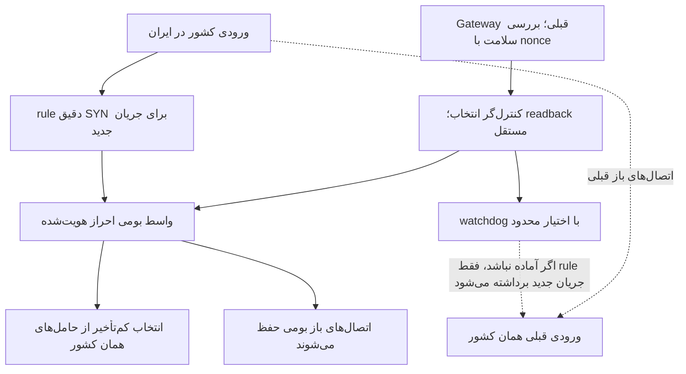

# واسط بومی و حفظ اتصال‌های قبلی

این تغییر، بخش جابه‌جایی دادهٔ Gateway پایتون را برای اتصال‌های جدید با sing-box جایگزین می‌کند. احراز هویت، خروجی‌های loopback و حامل‌های همان کشور حفظ می‌شوند. Gateway قبلی، بررسی سلامت و اتصال‌های باز خودش را ادامه می‌دهد. انتخاب کشور همچنان با مالک در XUI است.

## انتخاب مسیر

عضو باید متعلق به همان کشور باشد و شاهد کاربردی تازه و موفق داشته باشد. تأخیر نامعتبر، دادهٔ آینده یا کهنه و PID نادرست پذیرفته نمی‌شوند. میانهٔ چهار نمونه و حاشیهٔ ۳۰میلی‌ثانیه یا ۱۵٪، از تغییر مکرر انتخاب بر اثر نویز کوچک جلوگیری می‌کند. انتخاب جدید، اتصال باز را نمی‌بندد. اگر هیچ عضو معتبر نباشد، اتصال تازهٔ آن انتخاب‌گر رد می‌شود.

پاسخ موفق API به‌تنهایی کافی نیست؛ انتخاب با GET دوباره خوانده می‌شود. worker و child بومی در خطای کنترل API زنده می‌مانند. watchdog فقط ورود جریان جدید را پس می‌گیرد؛ سرویس یا conntrack دیگران را کنترل نمی‌کند. PID بومی همراه با start ticks، boot ID، مسیر executable، config و cgroup کنترل می‌شود تا PID بازیافتی معتبر فرض نشود.

## نکتهٔ مهم NAT

در fixture واقعی nft، حذف آخرین rule از نوع REDIRECT در یک namespace خالی می‌توانست اتصال از قبل ترجمه‌شده را مختل کند. به همین دلیل، rule هویتی اختصاصی «پورت جدید به همان پورت جدید» نگه داشته می‌شود. هنگام توقف انتشار جریان جدید، این anchor و اجازهٔ INPUT مربوط به اتصال‌های committed حذف نمی‌شوند. حذف آن‌ها نیازمند اثبات مالکیت و بی‌فعالیتی مستقل است.

## محدودیت پذیرش اتصال

Gateway پایتون پیش از احراز هویت، اتصال‌های جاری و handshakeهای پذیرفته‌شده را در `max_connections` حساب می‌کند. این مقدار برای ترکیه ۱۰۲۴ و آمریکا ۲۰۴۸ است. سازندهٔ config بومی این رفتار را منتقل نمی‌کند و گزینهٔ معادلِ تأییدشده‌ای در config فعلی وجود ندارد. سقف حافظهٔ 768MiB، تعداد task برابر ۲۵۶ و فایل باز ۶۵۵۳۶، سقف اتصال کاربردی نیستند؛ رسیدن به سقف حافظه حتی می‌تواند فرایند را متوقف کند.

در نتیجه، پذیرش محدود فایل کوچک به معنای حفظ سقف اتصال قبلی نیست و مجموع اتصال‌های فرایند قدیمی و بومی کنترل نشده است. نصب کشور بعدی تا بررسی این اختلاف متوقف است. مشاهدهٔ ۴۵۱ اتصال بومی و ۵۰ اتصال قدیمی آمریکا همراه با فضای حافظهٔ موجود، به‌تنهایی نشانهٔ رسیدن به حد منابع نبود؛ با این حال مجوز ظرفیت بالاتر هم محسوب نمی‌شود.

اصلاح بعدی باید پذیرش اتصال جدید و handshakeهای معطل را محدود کند و هم‌زمان، جریان‌های باز و PIDها را حفظ کند. آزمون محلی باید حالت N اتصال، اتصال N+1، هم‌پوشانی فرایند قدیمی/بومی و ادامهٔ تبادل روی اتصال‌های باز را بررسی کند. تا زمان چنین اثباتی، هیچ سقف تجمیعی یا تحمل اضافه‌بار برای نسخهٔ بومی ادعا نمی‌شود. فایل‌های committed، سرویس‌ها و ruleهای نگه‌دارندهٔ اتصال باز برای حل این اختلاف خودکار تغییر یا حذف نمی‌شوند.

## آزمون و سطح شواهد

در Linux محلی، دو namespace، veth، rule واقعی، واحدهای واقعی systemd و child واقعی sing-box استفاده شدند. موارد زیر PASS و پاک‌سازی محیط محلی نیز تأیید شد:

- اجرای منقضی بدون commit با exit 78 رد شد.
- فعال‌سازی boot پیش از commit بدون restart و تغییر PID انجام شد.
- خطای API 503 فقط انتشار جریان جدید را برداشت؛ اتصال‌های باز قدیمی، بومی مستقیم و بومی ترجمه‌شده ادامه یافتند.
- readback ناهماهنگ اصلاح شد.
- در آزمون محلی معادل راه‌اندازی مجدد، هویت PID جدید پیش از انتشار تأیید شد؛ این آزمون reboot سرور تولیدی نبود.

baseline این fixture شبیه‌سازی شده و WAN آن صفر بایت است. [رسید محلی](../evidence/native-front-local-lifecycle.json) و [کد fixture](../integration/native_front_lifecycle_fixture.py) منتشر شده‌اند. fixture به Linux جداگانه، root، systemd و namespace شبکهٔ خالی نیاز دارد؛ روی میزبان کاربران اجرا نشود. مسیر binary محلی با `SING_BOX_BINARY` داده و SHA آن بررسی می‌شود.

وضعیت واقعی سرور، جداگانه در [دادهٔ کارایی](../evidence/cpu-incident.json) و README ثبت می‌شود. انتقال موفق فایل 16KiB، ظرفیت، کاهش CPU کل سرور، کیفیت همهٔ کاربران یا بازی واقعی را ثابت نمی‌کند. هنوز انتقال خودکار کاربر از T6 انجام نمی‌شود و WARP نیز جزء این تغییر نیست.

## نصب محدود ترکیه

ترکیه با baseline تازهٔ IR/GW/TR، ممیزی شبکه و منابع تازه، گیت محدود را گذراند. ورودی TCP 32103 برای SYNهای دقیقاً متعلق به مسیر ایران، به listener بومی 8871 روی GW هدایت می‌شود. کنترل محلی 8875 و listener رد اتصال 8876 هستند. واحدهای boot پیش از commit و با همان PID فعال شدند؛ reboot سرور تولیدی انجام نشد. Gateway قبلی و تمام حامل‌های جاری restart نشدند و مسیرهای UDP تحویل‌شده تغییر نکردند.

نسخهٔ آمریکا در نوبت اول به علت افت تأخیر pause شد. پس از baseline، origin و nonce تازه و آزمون مرحله‌ای با گیت سخت‌تر، همان سرویس committed بدون restart پذیرش محدود گرفت: فایل قدیمی 1.167s، سایه 0.778s و منتشرشده 0.948s. جریان‌های جدید ورودی 32104 به واسط بومی 8681 می‌روند؛ کنترل محلی 8685 و رد اتصال 8686 است. آزمایش یا origin منقضی دوباره راه‌اندازی نشد.

برای آلمان، تلاش تازه در baseline متوقف شد و علت دقیق guard خوانده نشد؛ SSH بعدی رد شد. فنلاند نیز آن زمان پیش از نصب در دسترسی مدیریت متوقف شد. در بررسی تازهٔ بعدی، pinned SSH هر دو با یک تلاش از رکورد مجاز مالک برگشت و هفت سرویس قدیمی هر کشور فعال بودند. نصب بومی آن‌ها هنوز انجام نشده و گسترش نصب به علت اختلاف کنترل پذیرش متوقف است. این وضعیت‌ها مجوز restart آزمایش منقضی یا استفاده از mapping نامنطبق سرور دیگر نیستند.

برای آزمون‌های تازهٔ بعدی، [probe محدود](../experimental/bounded_tcp_probe.py) زمان اتصال TCP، مذاکره و احراز هویت Gateway، اتصال مقصد، رسیدن header و تکمیل SHA فایل را جدا ثبت می‌کند. یک deadline مطلق ۱۵ثانیه‌ای دارد و فقط یک پاسخ 16KiB را می‌خواند. این ابزار، ابزار speed test یا ترافیک انبوه نیست.

گسترش نصب فقط یک یادآوری در مستندات نیست: [گیت نصب](../experimental/native_front_rollout_gate.py) در ورودی نصب تازه و تابع deploy، پیش از ساخت controller یا SSH، اجرا را رد می‌کند. بازکردن آن نیازمند پیاده‌سازی و fixture واقعی کنترل پذیرش است؛ flag برای نادیده‌گرفتن آن وجود ندارد. این گیت، فرایندهای committed یا انتشار جاری را کنترل نمی‌کند.

## نمونهٔ محلی کنترل پذیرش؛ رد به علت هزینهٔ CPU

[relay آزمایشی](../experimental/native_tcp_admission.py) فقط روی loopback محلی bind می‌شود و به نصب تولیدی متصل نیست. ظرفیت پیش از هر await یا اتصال backend رزرو می‌شود؛ کلاینت idle و handshake معطل هم ظرفیت اشغال می‌کنند. فقط پاسخ‌های سرور SOCKS دیده می‌شوند و username/password نگه‌داری نمی‌شود. handshake مهلت محدود دارد؛ اتصال برقرارشده با idle بودن حذف نمی‌شود و نیم‌بسته‌شدن هر جهت حفظ می‌شود. توقف یا restart این relay، جریان‌های خودش را قطع می‌کند و برای تولیدی مجوز auto-restart ندارد.

چهار آزمون واقعی TCP شامل N/N+1، auth/timeout، half-close و خطای backend/cancellation گذشتند. [fixture واقعی sing-box در Linux جدا](../integration/native_admission_fixture.py) نیز نشان داد نسخهٔ مستقیم، چهار handshake با سقف قدیمی۳ را می‌پذیرد؛ relay چهارمی را پیش از ساخت backend رد می‌کند و SHA دادهٔ اتصال‌های باز پس از رد و تغییر selector درست می‌ماند. cleanup تمام فرایندهای محلی تأیید شد و WAN صفر بود.

این یک سقف **برای هر front** است؛ در هم‌پوشانی، K=3 قدیمی و N=3 بومی، شش اتصال زنده ماندند. سقف تجمیعی K حفظ نمی‌شود و kernel listen/SYN backlog هم خارج از این شمارش است. snapshot تعداد اتصال‌های فعال قدیمی، handshakeهای خصوصی آن را نشان نمی‌دهد؛ بدون مشارکت همان سرویس یا کنترل مشترک تمام پذیرش‌ها، برابری سخت سقف تجمیعی از snapshot اثبات نمی‌شود.

نمونه برای کاهش CPU رد شد: در همان داده، upstream و هم‌زمانی محلی، front قدیمی0.24s، بومی مستقیم0.17s و بومی+relay مجموعاً0.49s زمان CPU داشتند. **نصب نشده و گیت rollout باز نشده است.** [رسید پالایش‌شده](../evidence/native-admission-local.json) شکست کارایی را حفظ می‌کند. گام بعد، بررسی کنترل داخل مسیر بومی با build و آزمون واقعی است؛ گزینهٔ config تأییدنشده به binary موجود اضافه نمی‌شود.

## کنترل پذیرش داخل binary؛ فقط توسعه

نسخهٔ منبع سفارشی بدون hop پایتون در توسعه ساخته شد و آزمون واقعی N/N+1، حفظ جریان مستقل در خطا و half-close را گذراند. نمونهٔ CPU داخلی0.19s در برابر pristine0.16s و قدیمی0.24s ثبت شد، با محدودیت نمونهٔ کوتاه و ترتیبی. سقف تجمیعی K و پذیرش کارایی هنوز حل نشده‌اند؛ گیت نصب بسته است. [patch، fixture و منشأ دقیق](NATIVE-ADMISSION-INLINE.fa.md) را ببینید.
