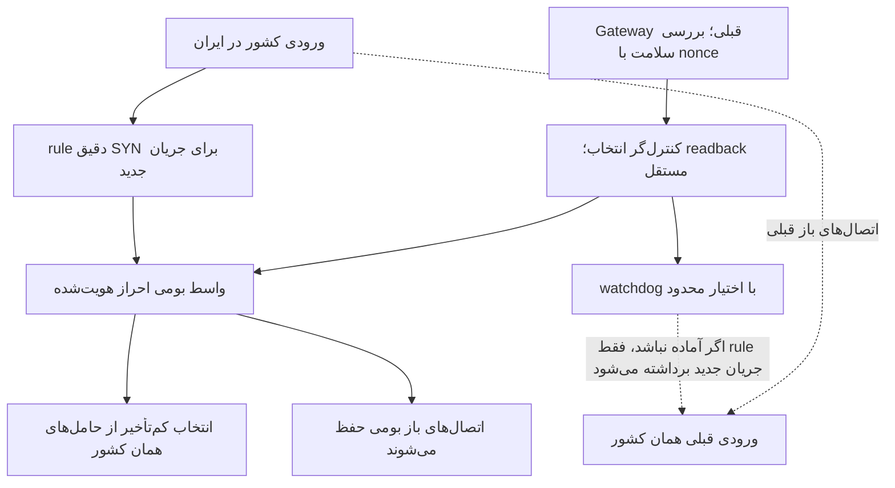

# واسط بومی و حفظ اتصال‌های قبلی

این تغییر، بخش جابه‌جایی دادهٔ Gateway پایتون را برای اتصال‌های جدید با sing-box جایگزین می‌کند. احراز هویت، خروجی‌های loopback و حامل‌های همان کشور حفظ می‌شوند. Gateway قبلی، بررسی سلامت و اتصال‌های باز خودش را ادامه می‌دهد. انتخاب کشور همچنان با مالک در XUI است.

## انتخاب مسیر

عضو باید متعلق به همان کشور باشد و شاهد کاربردی تازه و موفق داشته باشد. تأخیر نامعتبر، دادهٔ آینده یا کهنه و PID نادرست پذیرفته نمی‌شوند. میانهٔ چهار نمونه و حاشیهٔ ۳۰میلی‌ثانیه یا ۱۵٪، از تغییر مکرر انتخاب بر اثر نویز کوچک جلوگیری می‌کند. انتخاب جدید، اتصال باز را نمی‌بندد. اگر هیچ عضو معتبر نباشد، اتصال تازهٔ آن انتخاب‌گر رد می‌شود.

پاسخ موفق API به‌تنهایی کافی نیست؛ انتخاب با GET دوباره خوانده می‌شود. worker و child بومی در خطای کنترل API زنده می‌مانند. watchdog فقط ورود جریان جدید را پس می‌گیرد؛ سرویس یا conntrack دیگران را کنترل نمی‌کند. PID بومی همراه با start ticks، boot ID، مسیر executable، config و cgroup کنترل می‌شود تا PID بازیافتی معتبر فرض نشود.

## نکتهٔ مهم NAT

در fixture واقعی nft، حذف آخرین rule از نوع REDIRECT در یک namespace خالی می‌توانست اتصال از قبل ترجمه‌شده را مختل کند. به همین دلیل، rule هویتی اختصاصی «پورت جدید به همان پورت جدید» نگه داشته می‌شود. هنگام توقف انتشار جریان جدید، این anchor و اجازهٔ INPUT مربوط به اتصال‌های committed حذف نمی‌شوند. حذف آن‌ها نیازمند اثبات مالکیت و بی‌فعالیتی مستقل است.

## آزمون و سطح شواهد

در Linux محلی، دو namespace، veth، rule واقعی، واحدهای واقعی systemd و child واقعی sing-box استفاده شدند. موارد زیر PASS و پاک‌سازی محیط محلی نیز تأیید شد:

- اجرای منقضی بدون commit با exit 78 رد شد.
- فعال‌سازی boot پیش از commit بدون restart و تغییر PID انجام شد.
- خطای API 503 فقط انتشار جریان جدید را برداشت؛ اتصال‌های باز قدیمی، بومی مستقیم و بومی ترجمه‌شده ادامه یافتند.
- readback ناهماهنگ اصلاح شد.
- در آزمون محلی معادل راه‌اندازی مجدد، هویت PID جدید پیش از انتشار تأیید شد؛ این آزمون reboot سرور تولیدی نبود.

baseline این fixture شبیه‌سازی شده و WAN آن صفر بایت است. [رسید محلی](../evidence/native-front-local-lifecycle.json) و [کد fixture](../integration/native_front_lifecycle_fixture.py) منتشر شده‌اند. fixture به Linux جداگانه، root، systemd و namespace شبکهٔ خالی نیاز دارد؛ روی میزبان کاربران اجرا نشود. مسیر binary محلی با `SING_BOX_BINARY` داده و SHA آن بررسی می‌شود.

وضعیت واقعی سرور، جداگانه در [دادهٔ کارایی](../evidence/cpu-incident.json) و README ثبت می‌شود. انتقال موفق فایل 16KiB، ظرفیت، کاهش CPU کل سرور، کیفیت همهٔ کاربران یا بازی واقعی را ثابت نمی‌کند. هنوز انتقال خودکار کاربر از T6 انجام نمی‌شود و WARP نیز جزء این تغییر نیست.
